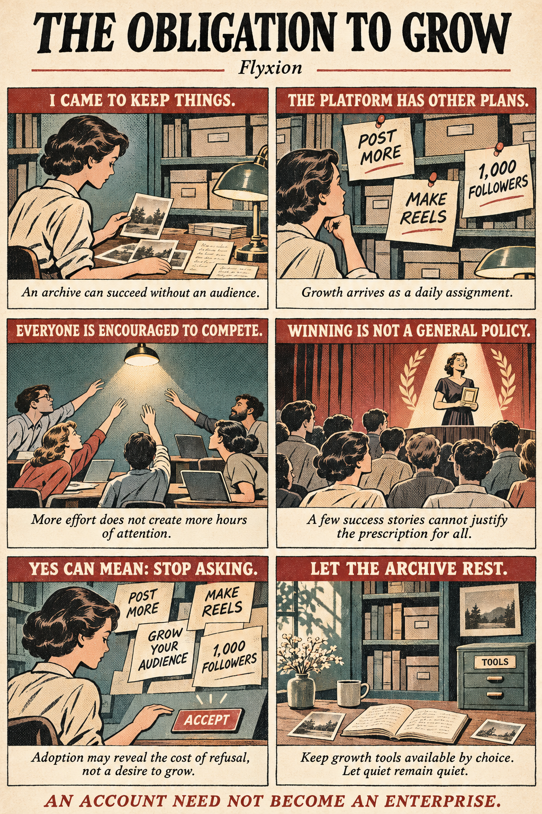

# Why Social Platforms Are Forcing You to Act Like a Startup (And Why It’s Breaking the Internet)

## 1. The Unspoken Tax of Having an Online Presence

Most online accounts begin with modest human intentions: storing personal photographs, keeping private study notes, bookmarking articles, or maintaining quiet touch with a few friends. Yet, the moment you log into a modern platform, you are met with interface features engineered to push those quiet repositories toward continuous audience expansion.

The central problem of modern digital design is how platforms systematically convert an optional feature, building an audience, into a default expectation of participation. What was conceived as a tool for personal retrieval or targeted sharing is transformed by interface defaults into an enterprise requiring optimization, analytics, and relentless growth.

This structural push to turn quiet archives into public broadcasts highlights a deep human tension, one observed centuries ago by Blaise Pascal:

> "All the unhappiness of men comes from one single thing, which is not knowing how to remain at rest in a room." ,  Blaise Pascal

## 2. Your Quiet Digital Archive is Being Forced to Act Like a Startup

When an individual creates a digital space to store study material or photographs, the administrative interface of the platform rarely respects that quiet boundary. Instead, platform design treats passive archives or completed personal records as uncompleted ventures awaiting commercial expansion.

### From Option to Expectation

Administrative dashboards (such as those on Facebook Pages) actively nudge users toward enterprise behaviors. Interfaces issue automated reminders to post on a regular schedule, prompts to reply to commenters, notices to thank new followers by name, threshold celebrations for round follower counts, and explicit format recommendations designed to "extend reach." Through these mechanics, an account kept simply as a searchable record is reframed as an underperforming business.

### Everyone as Founder

This interface dynamic reflects a broader social condition described in the essay Everyone as Founder. Neoliberal pressure forces individuals and households into founder-like roles where personal survival is linked to continual self-promotion. Under this paradigm, a lack of numerical growth is framed as personal failure or inadequacy rather than a natural, systemic choice to keep a project modest.

### The Instructional Logic of la Technique

This pressure operates through what sociologist Jacques Ellul called la technique, the systematic application of rationalized methods optimized purely for efficiency. The platform interface does not constrain users through explicit prohibitions; instead, it provides relentless, "helpful" encouragement. By offering prompts to thank followers or adopt reach-extending formats, the interface instructs the user to adopt habits that serve the platform's operational logic.

### Why the Structural Push Happens

As detailed in The Hostile Interface, this push stems directly from the platform's ad-supported revenue model. In an environment where personal communication is not the final service but an input to an advertising business, user content and social connections are material around which advertisements are placed. Encouraging users to post more frequently, maximize responses, and enlarge their audience directly supplies the ongoing inventory the underlying ad business requires.

> "The archive is treated as an audience-building project awaiting further development, and its modest, finished state is rendered as a shortfall."

## 3. The "Winner's Strategy" Fallacy, Why Advice for Creators Fails at Scale

Growth strategies are frequently presented as universal best practices: "make short vertical videos" or "invite controversial guests to boost engagement." While these recommendations may accurately reflect what improves a single account's competitive position at a given moment, they collapse into a structural fallacy when generalized across an entire population.

### Positional Competition and Tullock Attention Contests

Attention is strictly bounded by the fixed hours in a day. While audience attention cannot expand beyond these natural human limits, the aggregate effort and expenditure devoted to capturing that attention can increase indefinitely. Content creators can double their production schedule, refine editing techniques, and join promotional pods, but total human attention remains capped.

Because attention is a positional good, an account's gain in visibility generates a direct zero-sum externality (ε = −Dₖ) on everyone else: the reach won by an adopter is directly subtracted from non-adopters. This locks participants into what economists call a Tullock attention contest. Aggregate escalation dissipates total effort and resources without expanding the underlying attention pool.

**Individual Logic:** "If I publish short vertical videos, I will gain a competitive advantage over static accounts."
**Aggregate Reality:** "When every account posts short vertical videos, relative rankings remain largely unchanged, but everyone must spend twice as much time editing just to hold their original position."

### Survivorship Bias in Platform Metrics

The advice given to creators is systematically corrupted by survivorship bias. Platform algorithms, recommendations, and curated showcases highlight the small fraction of accounts that achieved massive growth. They conceal the vastly larger pool of creators who followed identical strategies, produced content on schedule, and received no audience expansion. Because the unsuccessful majority remains invisible, individual success stories cannot logically justify universal prescriptions for growth.

## 4. The Truman Show Inversion, Making Your Life Watchable as an "Achievement"

The modern creator economy has fundamentally inverted long-standing cultural narratives regarding privacy, surveillance, and public visibility. In Peter Weir’s 1998 film The Truman Show, the protagonist’s central conflict is his desperate struggle to escape a life engineered for public observation. Surveillance is framed as an unwanted imposition, and privacy is the ultimate human freedom to be reclaimed. The contemporary creator ecosystem completely inverts this dynamic: it encourages individuals to make their private lives deliberately watchable, framing the arrangement of one's existence for spectators as a desirable achievement and a legitimate career path.

Successful creators in this system inhabit a double role: for viewers, they serve as a continuous source of entertaining media; for prospective creators, they act as living proof of an available, lucrative future. However, this dynamic masks a fundamental economic reality. Universal access to the means of production, cheap smartphone cameras, editing apps, and free platform hosting, does not translate to universal access to a sustainable income. The high visibility of accessible publishing tools quietly masks the extreme scarcity of financial survival, shifting the cultural baseline from preserving privacy to pursuing an audience.

## 5. You’re Not Convinced, You’re Just Exhausted (The Math of Constant Nudging)

Platforms frequently point to high feature adoption as proof that users inherently want to build audiences. However, formal mathematical analysis of platform dynamics reveals that systems can induce users to adopt growth practices even when those users derive zero intrinsic value from doing so.

Through the mathematics of Repeated Solicitation, platforms alter user behavior not by persuading them, but by taxing their refusal. Consider a user who prefers a quiet archive. As long as the account remains quiet, automated platform actions generate a continuous stream of notifications, pop-up reminders, and growth suggestions arriving at rate λ. Each dismissal imposes a small cost in time, attention, and cognitive friction (d). Discounted over time at rate r, the cumulative expected cost of continually declining these prompts accumulates into an ongoing administrative tax:

CQ = λd / r

When the one-time friction of adopting the growth feature (L) is smaller than the endless tax of declining it (L < λd / r), immediate adoption becomes mathematically rational, simply to make the prompts stop.

Repeated solicitation changes the cost of declining while leaving the user's underlying preference unchanged, turning fatigue into apparent consent.

## 6. The Case for "Archival Autonomy" and the Right to Leave an Artifact Alone

To break this cycle of forced optimization, platforms must respect Archival Autonomy, the principle that a digital artifact should be allowed to exist in quiet completion without reaction counters, metric badges, or perpetual invitations to circulate.

As detailed in the Gallery Before Feed framework, an artifact encountered in an archive exists on its own terms. In a standard algorithmic feed, that same artifact is transformed into a real-time bid for attention, where its perceived worth is tied directly to response metrics. Retrieval, spaced repetition, personal research, and historical record-keeping are valid states of digital life. A page fulfills its purpose completely even if its audience remains a single person for a decade. Silence and completion are not errors or "inactivity" to be algorithmically corrected.

Crucially, Flyxion’s formal models distinguish between a fragile quiet default (which an automated platform notification easily breaks) and an explicit Archival Invariant (τ(Q, (U ∖ U₁) ⊔ P) ⊆ Q). Under an archival invariant, an account is mathematically guaranteed to remain in a quiet state (Q) across all autonomous platform actions (P) and routine user actions (U₀). Moving out of a quiet state requires an affirmative, explicit opt-in action (U₁).

The core design rule for healthy digital infrastructure must be: Growth must require an explicit, intentional purpose beyond growth itself.

### Proposed Interface Standards for Archival Autonomy

**Archival Invariance by Default:** Interface states must structurally maintain quiet archival modes, remaining invariant against automated notification badges, aggregate counters, or scheduled growth prompts unless explicit opt-in (U₁) occurs.
**Metrics on Demand:** Numerical metrics (likes, reach, follower counts) should be hidden by default and rendered strictly when explicitly requested by the user.
**Affirmative Opt-In for Growth:** Growth-oriented tools and promotional features must require intentional opt-in gestures, ensuring that remaining quiet requires zero recurring acts of refusal.

## 7. Conclusion: An Account Need Not Become an Enterprise

Having the option to seek an audience, publish work globally, or build a commercial enterprise online is a powerful technical capability. However, converting that option into an unasked-for default expectation destroys digital sanity and distorts basic human communication.

Platforms often point to user activity metrics to claim success. But engagement counters measure only how much activity an interface generates, not whether it actually serves the purpose for which human beings arrived. Storing study notes, sharing photographs with friends, or maintaining a quiet archive are complete, valuable human acts that require no further expansion.

An account need not become an enterprise. What would your digital life look like if your archives, notes, and records were allowed to remain quietly at rest?

